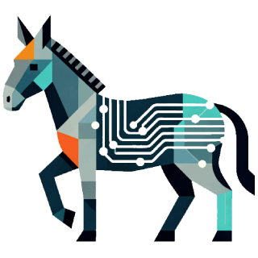
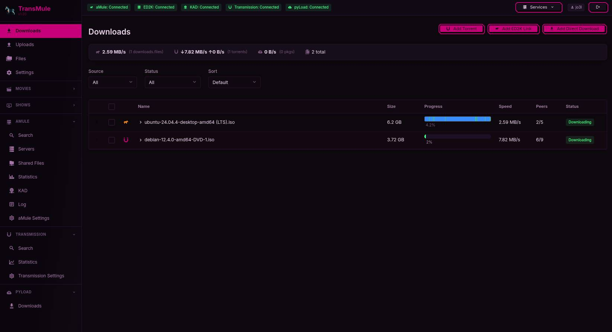

<div align="center">
  
  
<pre>
 ______   ______    ______    __   __    ______    __    __    __  __    __        ______   
/\__  _\ /\  == \  /\  __ \  /\ "-.\ \  /\  ___\  /\ "-./  \  /\ \/\ \  /\ \      /\  ___\  
\/_/\ \/ \ \  __<  \ \  __ \ \ \ \-.  \ \ \___  \ \ \ \-./\ \ \ \ \_\ \ \ \ \____ \ \  __\  
   \ \_\  \ \_\ \_\ \ \_\ \_\ \ \_\\"\_\ \/\_____\ \ \_\ \ \_\ \ \_____\ \ \_____\ \ \_____\
    \/_/   \/_/ /_/  \/_/\/_/  \/_/ \/_/  \/_____/  \/_/  \/_/  \/_____/  \/_____/  \/_____/
</pre>                                                                                                    

  # TransMule — Unified Self-Hosted Download Manager

  <p align="center">
    <strong>One dashboard to manage aMule (ED2K/Kademlia), Transmission (BitTorrent), Slskd (Soulseek) and pyLoad NG (direct downloads)</strong>
  </p>

  <p align="center">
    <a href="https://github.com/Jo3l/transmule/releases"></a>
    <a href="https://github.com/Jo3l/transmule/stargazers"></a>
    <a href="https://github.com/Jo3l/transmule/actions/workflows/docker-publish.yml"></a>
    <a href="https://github.com/Jo3l/transmule/pkgs/container/transmule"></a>
    <a href="https://github.com/Jo3l/transmule/blob/main/LICENSE"></a>
    <a href="https://github.com/Jo3l/transmule/issues"></a>
  </p>

  <p align="center">
    <a href="#install">Install</a> •
    <a href="docs/manual-install.md">Manual install</a> •
    <a href="#nas-unraid-and-synology">Unraid</a> •
    <a href="#features">Features</a> •
    <a href="#quick-start">Quick Start</a> •
    <a href="#architecture">Architecture</a> •
    <a href="#plugin-system">Plugins</a> •
    <a href="#environment-variables">Configuration</a> •
    <a href="#development">Development</a> •
    <a href="#faq--troubleshooting">FAQ</a>
  </p>

  <p align="center">
    🌐 <strong>English</strong> • Español • Português • Italiano • Deutsch • Polski • Türkçe • Русский • हिन्दी
  </p>

  
  <br><em>TransMule dashboard — unified view of all your downloads</em>
</div>

<br>

---

> **TransMule** is a modern, self-hosted web interface that unifies four download ecosystems — **aMule** (ED2K/Kademlia), **Transmission** (BitTorrent), **Slskd** (Soulseek) and **pyLoad NG** (direct/one-click hosting) — into a single dashboard. Deployed via Docker Compose, it works on any architecture (x86_64 and ARM64) and includes a built-in file manager with remote storage mounts, media preview, archive utilities, extensible plugin system, multi-user auth, and full i18n support. All in one container with a single `docker compose up -d`. Its built-in **media planner** tracks the TV shows and movies you follow across ED2K, Soulseek and BitTorrent, with **Plex integration** to know exactly which episodes you already have.

## Install

Download the installer from a **release tag**, read it, run it pinned to that same tag — what you run is what you reviewed. No `git clone`, and no `.env` to edit by hand.

```bash
REL=v1.182
BASE="https://raw.githubusercontent.com/Jo3l/transmule/$REL"

curl -fsSLo install.sh "$BASE/install.sh"
less install.sh                  # optional: read it before running it
sh install.sh --ref "$REL"       # --ref keeps the compose/env it fetches on the same tag
```

`install.sh` is plain POSIX sh: version checks, `.env` generation, folder creation and the first `up`. `--ref` matters — without it the script fetches `docker-compose.yml` and `.env.example` from `main`, which moves. Replace `v1.182` with any tag from the [releases page](https://github.com/Jo3l/transmule/tags).

In a hurry, the same release in a single line:

```bash
sh -c "$(curl -fsSL https://raw.githubusercontent.com/Jo3l/transmule/v1.182/install.sh)" install --ref v1.182
```

The only prerequisite is Docker with the Compose v2 plugin. The script verifies it, asks a few questions with sensible defaults, generates its own secrets and starts the stack. Details and flags: [Quick Start](#quick-start).

Prefer to run no script at all? **[Manual installation](docs/manual-install.md)** does every step by hand — the `.env`, the folders, permissions, the one-time service configuration and updates by tag.

<br>

## Features

### Unified Download Management
| Feature | Description |
|---------|-------------|
| **Unified dashboard** | All downloads — aMule files, BitTorrent transfers, Soulseek downloads and pyLoad packages — in one sortable, filterable table with mobile card layout |
| **aMule integration** | Browse and search the ED2K/Kademlia network, manage downloads, view chunk availability, sources, friends, connected servers, KAD status and full preferences |
| **Transmission integration** | Add torrents via magnet link, URL or local `.torrent` file, control downloads, inspect peers/trackers/files, configure network and speed limits |
| **Slskd integration** | Search the Soulseek network, download files, browse user shares, chat in rooms and private messages, manage transfers |
| **pyLoad NG integration** | Add direct-download (DDL) packages, monitor link extraction status, stop/restart/delete packages with full queue management |
| **Torrent search** | Search multiple torrent indexes directly from the UI with live streaming results — extensible via plugins |

### Media Planner — Track Your Shows & Movies Across Every Network
| Feature | Description |
|---------|-------------|
| **Follow shows & movies** | Subscribe to any TV series or movie and TransMule keeps track of it for you — new episodes and releases are detected and queued automatically, across every network at once |
| **Multi-network tracking** | One subscription searches **ED2K (aMule), Soulseek (slskd) and BitTorrent simultaneously** — if a release exists anywhere on the three networks, the planner finds it |
| **Plex integration** | Connect your **Plex Media Server** and the planner knows exactly which episodes you already have: existing episodes are flagged in the UI, and each download can trigger an automatic library rescan — your Plex stays in sync |
| **Manual release review** | Candidates are scored and listed for you to review before anything downloads — pick the release you want in one click, no false positives, full control |
| **Smart quality & size matching** | Set minimum quality and maximum size per subscription; a scoring engine ranks candidates by how close they are to your target size, not just resolution — no more 10 GB downloads when you asked for ~1 GB |
| **Automatic organization** | After downloading, files are moved to the folder you choose and smart-renamed (no more `[www.example.com] Series.S01E02...` filenames) — ready for your media library |
| **Rich metadata** | Covers, synopses and localized titles from **TMDB/TVDB** — find Spanish, English or any-language releases, and let the planner match them to your Plex library even when titles differ between providers |

### File Management & Storage
| Feature | Description |
|---------|-------------|
| **Full file manager** | Browse, upload, download, rename, delete, move and copy files through a clean web interface |
| **Remote mounts** | Mount **SMB/CIFS** and **WebDAV** shares and manage remote files transparently as if they were local |
| **Extensible mount system** | Provider-agnostic architecture — adding new protocols (SFTP, NFS, S3, …) only requires implementing a small interface |
| **Archive utilities** | Compress files into zip/tar/tar.gz/tar.bz2/tar.xz (with optional password for zip), extract uploaded archives, smart rename media files |
| **Media preview** | In-browser image viewer, video player with streaming, and text editor for quick inspection |

### Share to Device (QR)

Pick any file or folder in the file manager, right-click → **Send to device…**, and TransMule hands you a QR code plus a link.

- The link points at the host you are already browsing, so it works over LAN or through your reverse proxy with no extra configuration.
- Expiry can be **1 hour, 1 day or 1 week** (24 h by default).
- Optionally protected by a **6-character code**. The code is never inside the QR: the receiving device types it on the page before the contents (even the file names) are revealed.
- Folders are **listed, not zipped** — every file is its own download, and local/SMB mounts behave identically.
- Links are revocable at any time and stop working immediately.

If your reverse proxy uses HTTP Basic auth, the browser will ask for it when the link is opened, exactly as when you browse the app. Files are streamed with `Range` support (resumable) for local storage; SMB downloads stream but cannot be resumed yet.

### Plugin System
| Feature | Description |
|---------|-------------|
| **Runtime plugins** | Upload `.js` plugins without restarting the server — they're active immediately after refresh |
| **Media providers** | Add sidebar browse/search for movies, shows, and more (YTS, DonTorrent, ShowRSS, etc.) |
| **Torrent search sources** | Add custom torrent indexers (PirateBay, YTS Search, Nyaa.si, TorrentClaw, etc.) |
| **Official plugins** | Maintained in [transmule-plugins](https://github.com/Jo3l/transmule-plugins) with a public manifest |

### User Experience
| Feature | Description |
|---------|-------------|
| **Multi-user auth** | JWT-based login with per-user preferences stored in SQLite |
| **Light / Dark themes** | Full theme support that respects system preference |
| **i18n** | English, Español, Português, Italiano, Deutsch, Polski, Türkçe, Русский, हिन्दी — 9 languages |
| **Mobile-friendly** | Responsive layout with card-based view on small screens |
| **Statistics** | Live aMule stats tree + Transmission session statistics |
| **API documentation** | Interactive Swagger docs at [`/_scalar`](http://localhost:3001/_scalar) |

### Webamp — Winamp in the Browser
| Feature | Description |
|---------|-------------|
| **Built-in player** | Embedded [Webamp](https://webamp.org) (Winamp v2 reimplementation) with Milkdrop visualizations via Butterchurn |
| **Audio playback** | Click any audio file in the file manager to play it, or drag & drop files onto the player |
| **Custom skins** | Install `.wsz` skins from [Winamp Skin Museum](https://skins.webamp.org) or any direct URL — supports live skin switching via `setSkinFromUrl()` |
| **Default / custom** | Switch between the built-in Base 2.4 skin or any installed custom skin; uses internal Redux action `LOAD_DEFAULT_SKIN` to reset |
| **Window layout** | Toggle Equalizer, Playlist, and Milkdrop windows independently. Double-size mode supported |
| **Persistence** | All preferences (skin, window state, size) are persisted to `localStorage` across sessions |

### Comic Reader
| Feature | Description |
|---------|-------------|
| **Supported formats** | CBZ, CBR, and PDF — extracted client-side via JSZip, libunrar, and pdf.js |
| **File manager integration** | Double-click any comic file in the file manager to open the reader |
| **View modes** | Single page, double page; swipe navigation (horizontal = page, vertical = toggle header) |
| **State persistence** | Reading position is saved in the URL hash (`#comic={path}|{page}`) via `history.replaceState()`, surviving page refreshes |
| **Header overlay** | Collapsible header with page counter, zoom controls, and page navigation dropdown |

<br>

## Quick Start

### Requirements

- **Docker** and **Docker Compose** (v2 or later) — that's all. No `git`, no Node.js, no `.env` to write by hand.
- Free host ports: `3001`, `4662`, `4672`, `51413`, `50300`. If one is busy the installer moves to the next free one.

### Install — one command

Open a terminal on the machine that will run TransMule. Download the installer from a tagged release, read it if you like, and run it against that same tag:

```bash
REL=v1.182
BASE="https://raw.githubusercontent.com/Jo3l/transmule/$REL"

curl -fsSLo install.sh "$BASE/install.sh"
less install.sh
sh install.sh --ref "$REL"
```

No `git clone`, and nothing to download or configure by hand: the script fetches the two files it needs (`docker-compose.yml` and `.env.example`) into the install folder, so there is no repository checkout to keep around. Add `--dry-run` to see what it would do without writing anything.

It runs as a wizard: it first checks Docker (>= 20.10) and Docker Compose (>= 2.0) and the daemon, then asks — step by step, with defaults — where to install, where to keep completed and in-progress downloads, the web port and the timezone. Nothing is written until you confirm. Then it generates a `.env` with random secrets, picks free host ports, creates the download folders with the right ownership, and either starts the five containers (waiting until the web UI answers) or leaves everything ready to run — your choice at the last question.

Re-running it upgrades an existing install (the `.env` and `data/` are preserved), so the same command is also the update command — with the tag of the release you want. `curl … | sh` works too (the questions are then read from `/dev/tty`), and `-y` runs it unattended.

Besides the `.env` and the folders, the installer applies the **one-time service configuration** and then forgets about it: Transmission gets its download/incomplete folders, RPC and peer port; aMule gets the image's internal ports, so no helper script has to run on every container start. Both live in the Docker volumes from then on. [Manual installation](docs/manual-install.md) documents both, and how to apply them yourself.

Useful flags: `--dir DIR`, `--downloads DIR`, `--incomplete DIR`, `--port N`, `--ref TAG`, `--platform NAME`, `--no-start`, `--dry-run`, `-y` (unattended). Run `install.sh --help` for the full list.

### NAS: Unraid and Synology

The installer detects the platform and adapts the defaults:

| Platform | Install dir | `PUID`/`PGID` |
|----------|-------------|---------------|
| Unraid | `/mnt/user/appdata/transmule` | `99` / `100` |
| Synology DSM | `/volume1/docker/transmule` | your user (or `1026`/`100` as root) |
| Anything else | `./transmule` | your user |

`docker-compose.yml` is self-contained — it mounts no host-side helper scripts — so it can also be pasted as-is into **Unraid → Compose Manager** or **Synology → Container Manager** with a `.env`. In that case you skip the one-time normalization (Transmission keeps its default `/downloads/complete` folder and aMule uses its own ports); everything else is configured from the web UI.

On Unraid the installer detects the **Docker Compose Manager** plugin and installs the stack into its projects folder (`/boot/config/plugins/compose.manager/projects/transmule/`), so it appears in *Docker → Compose* with its Update Stack and autostart buttons; downloads go to `/mnt/user/downloads` and the database to `/mnt/user/appdata/transmule`. Without the plugin it falls back to `/mnt/user/appdata/transmule`. **[`docs/unraid-compose-manager.md`](docs/unraid-compose-manager.md)** is the full walkthrough, including the by-hand path (drop the two files in the stack folder and press *Compose Up*).

### Ports to forward

Forward these on your router, otherwise P2P stays degraded:

| Host port | Protocol | Service | `.env` variable |
|-----------|----------|---------|-----------------|
| `3001` | TCP | Web UI + API | `TRANSMULE_PORT` |
| `4662` | TCP | aMule eD2K | `AMULE_ED2K_TCP_PORT` |
| `4672` | UDP | aMule eD2K + Kademlia | `AMULE_ED2K_UDP_PORT` |
| `51413` | TCP + UDP | Transmission peers | `TRANSMISSION_PEER_PORT` |
| `50300` | TCP | Soulseek (slskd) | `SLSKD_P2P_PORT` |

Without the eD2K ports aMule stays in **LowID** and downloads are slower. The installer moves to free ports when these are taken; **Settings → Ports** in the app checks whichever ports are in use. Only `3001` is really exposed: the Nitro API listens on `127.0.0.1:3000` inside the app container and nginx proxies `/api/*` and `/_scalar` to it.

### Install without the script (optional)

The whole stack is two files — `docker-compose.yml` and a `.env` — and it brings itself up with `docker compose up -d`. **[`docs/manual-install.md`](docs/manual-install.md) is the step-by-step guide**: pinned download, every `.env` value explained, folder ownership, the one-time service configuration, updates by tag, backups and troubleshooting.

The short version, for reference:

```bash
REL=v1.182
BASE="https://raw.githubusercontent.com/Jo3l/transmule/$REL"

mkdir -p ~/transmule && cd ~/transmule
curl -fsSLO "$BASE/docker-compose.yml"
curl -fsSLo .env "$BASE/.env.example"
# edit PUID/PGID, TZ, the three paths and the two secrets (the manual has the exact sed lines)
docker compose up -d
```

`.env` already ships with working defaults (`PUID`/`PGID`, folders, ports); adjust the paths and the user/group IDs to match your host — and leave `JWT_SECRET` empty to have the app generate and store one on first start.

The trade-off of this path: it skips the **one-time service configuration** the installer applies, so Transmission keeps its default `/downloads/complete` folder and aMule its own ports. That is harmless — both can be changed afterwards, and the manual shows how.

Then open **http://localhost:3001**; on first run you will be prompted to create an admin account.

| URL | What you get |
|-----|--------------|
| [http://localhost:3001](http://localhost:3001) | TransMule dashboard |
| [http://localhost:3001/_scalar](http://localhost:3001/_scalar) | Interactive API docs |

The five containers this starts:

- **app** — TransMule UI + API (nginx + Nitro, single container via supervisord)
- **amule** — aMule daemon (ED2K/Kademlia)
- **transmission** — BitTorrent client
- **slskd** — Soulseek client
- **pyload** — Direct download manager

### ARM64 / Raspberry Pi

The `docker-compose.yml` is fully ARM64-compatible. The TransMule image is published as a **multi-arch manifest** supporting both `linux/amd64` and `linux/arm64`. All service images are also multi-arch — no special configuration needed.

If you need to pin specific tags:

```env
TRANSMULE_APP_IMAGE=ghcr.io/jo3l/transmule:latest
AMULE_IMAGE=ngosang/amule:latest
TRANSMISSION_IMAGE=lscr.io/linuxserver/transmission:latest
SLSKD_IMAGE=slskd/slskd:latest
PYLOAD_IMAGE=lscr.io/linuxserver/pyload-ng:latest
```

<br>

## Architecture

```
Browser
  │
  └─ transmule-app (port 3001)
        │  nginx — serves Nuxt SPA (static files)
        │        — proxies /api/* and /_scalar → 127.0.0.1:3000
        │
        └─ Nitro API (127.0.0.1:3000, loopback only)
              ├─ JWT auth + user management (SQLite via better-sqlite3)
              ├─ CORS handling
              ├─► aMule EC protocol      (internal :4712)
              ├─► Transmission RPC       (internal :9091)
              ├─► Slskd Web UI + API     (internal :5030)
              └─► pyLoad NG API          (internal :8000)
```

The frontend (Nuxt 3 SPA) and the Nitro API share a single container managed by supervisord. nginx handles static file serving and proxies API traffic to Nitro on the loopback interface — no IP address is ever baked into the image.
**All inter-service communication** happens on an internal Docker network. aMule EC, Transmission RPC, Slskd API and pyLoad API are never exposed to the host. The Nitro API listens on `127.0.0.1:3000` inside the app container exclusively.

<br>

## Plugin System

TransMule has a **runtime plugin system** in JavaScript. Upload a `.js` file via **Settings → Providers** and it's active immediately after page reload — no server restart needed.

### Plugin types

| Type | Purpose | Examples |
|------|---------|----------|
| **Media** (`mediaType`) | Sidebar browse/search for content types (movies, shows, anime) | YTS, DonTorrent, ShowRSS, TorrentClaw Popular |
| **Torrent Search** (`pluginType: \"torrent-search\"`) | Custom index source for the torrent search page | PirateBay, YTS Search, Nyaa.si, TorrentClaw |

### Official plugins

| Plugin | Type | Description |
|--------|------|-------------|
| `yts` | movies | Movie browse/search via YTS.mx with quality & genre filters |
| `dontorrent-movies` | movies | Spanish movie torrents from dontorrent.link |
| `dontorrent-shows` | shows | Spanish series torrents from dontorrent.link |
| `showrss` | shows | TV show torrents from your personal ShowRSS RSS feed |
| `torrentclaw-popular` | movies / shows | Popular torrents from TorrentClaw with metadata |
| `nyaa` | torrent-search | Anime & manga torrents via nyaa.si |
| `piratebay` | torrent-search | General torrents via apibay.org JSON API |
| `yts-search` | torrent-search | Movie torrents via YTS.mx JSON API |
| `torrentclaw` | torrent-search | Torrent search via TorrentClaw API with quality scores |

> Download from [github.com/Jo3l/transmule-plugins](https://github.com/Jo3l/transmule-plugins)

<br>

## Environment Variables

| Variable | Default | Description |
|----------|---------|-------------|
| `PUID` / `PGID` | `1000` | Host user/group IDs for file permissions |
| `TZ` | `Europe/Madrid` | Timezone |
| `DOWNLOAD_DIR` | `./downloads` | Completed downloads host path |
| `INCOMPLETE_DIR` | `./incomplete` | In-progress downloads host path |
| `DATA_DIR` | `./data` | Middleware SQLite database directory |
| `TRANSMULE_PORT` | `3001` | Host port for the web UI + API |
| `AMULE_ED2K_TCP_PORT` | `4662` | Host port for aMule eD2K (TCP) |
| `AMULE_ED2K_UDP_PORT` | `4672` | Host port for aMule eD2K + Kademlia (UDP) |
| `TRANSMISSION_PEER_PORT` | `51413` | Host port for BitTorrent peers (TCP + UDP) |
| `SLSKD_P2P_PORT` | `50300` | Host port for Soulseek (TCP) |
| `AMULE_GUI_PASSWORD` | — | aMule EC protocol password (port 4712) |
| `TRANSMISSION_USER` / `TRANSMISSION_PASS` | _(empty)_ | Transmission RPC credentials |
| `JWT_SECRET` | _(auto)_ | Secret for signing JWT tokens. Leave it empty and the app generates one on first start, kept in `DATA_DIR/.jwt_secret` |
| `SLSKD_USERNAME` / `SLSKD_PASSWORD` | — | Soulseek credentials (configured via UI — optional in .env) |
| `PYLOAD_USER` / `PYLOAD_PASSWORD` | `pyload` | pyLoad NG credentials |
| `TRANSMULE_APP_IMAGE` | `ghcr.io/jo3l/transmule:latest` | Optional app image override |
| `AMULE_IMAGE` | `ngosang/amule:latest` | Optional aMule image override |
| `TRANSMISSION_IMAGE` | `lscr.io/linuxserver/transmission:latest` | Optional Transmission image override |
| `SLSKD_IMAGE` | `slskd/slskd:latest` | Optional Slskd image override |
| `PYLOAD_IMAGE` | `lscr.io/linuxserver/pyload-ng:latest` | Optional pyLoad image override |
| `TMDB_API_KEY` | — | TMDB API key for cover artwork |
| `TVDB_API_KEY` | — | TVDB API key for cover artwork (fallback) |

<br>

## Development

### Requirements
- Node.js 20+
- Docker (for back-end services: aMule, Transmission, pyLoad)

### Source checkout

Development is the only reason to clone the repository — installing does not need it:

```bash
git clone https://github.com/Jo3l/transmule.git
cd transmule
```

### Setup

```bash
# Start back-end services only
docker compose -f docker-compose.dev.yml up -d

# Middleware (hot-reload)
cd middleware && npm install && npm run dev

# Frontend (hot-reload)
cd frontend && npm install && npm run dev
```

Or use the convenience script at the root:

```bash
./dev.sh
```

### Building the Docker image

```bash
docker build -t transmule:dev .
```
<br>

## FAQ & Troubleshooting

### "Can't connect to aMule"
- Verify EC is enabled in aMule: Preferences → Remote Controls → External Connections
- Check the EC password matches `AMULE_GUI_PASSWORD` in `.env`
- Ensure the aMule container is running: `docker compose ps`

### "Can't connect to Transmission"
- Verify RPC is accessible: `curl http://host:9091/transmission/rpc` (a `409` response means RPC is working)
- If RPC auth is enabled, set `TRANSMISSION_USER` and `TRANSMISSION_PASS` in `.env`

### "Can't connect to pyLoad"
- Verify the pyLoad container is running
- Default credentials are `pyload` / `pyload` — configure via `PYLOAD_USER` / `PYLOAD_PASSWORD`

### "Port 3001 is already in use"
- Re-run the installer and answer a different web port (or pass `--port 4000`) — it repoints the stack without touching your data
- Manually: set `TRANSMULE_PORT=4000` in `.env` and `docker compose up -d`

### "File permission errors"
- Ensure `PUID` and `PGID` in `.env` match your host user's IDs
- Run `id` on the host to check: `id -u` (UID), `id -g` (GID)

### "How do I add a torrent?"
- On **Downloads**, click **Add Torrent**. Paste magnets/URLs (one per line) in the textarea, or pick a local `.torrent` with the **Torrent file** button below it — while a file is selected it takes precedence over the text.
- Local files must be valid `.torrent` metainfo, up to **5 MiB**. **Add paused** works with either option. Transmission uses its configured download directory and reports existing torrents without adding a second copy.
- Uploads require your normal TransMule login. Files are validated in memory and forwarded through the existing Transmission RPC connection; no server-side source file or upload directory is needed.
- For isolated tests and endpoint details, see [Torrent file uploads](docs/torrent-file-upload.md).
- Go to **Transmission → Torrent Search** in the sidebar
- Search, select results, and click the download button — the torrent is sent directly to Transmission

### "Do I need to clone the repository or install Node.js?"
No. Installing is one command — download the installer from a tagged release and run it against that tag (see [Install](#install)): it pulls the compose file and the env template into the install folder itself. Node.js and the repository checkout are only needed if you want to run TransMule from source (see [Development](#development)).

### "How do I update TransMule?"
Re-run the installer with the tag of the new release — it detects the existing install, keeps `.env` and `data/`, refreshes the compose file and pulls the new image.

```bash
REL=v1.182                      # the release you are moving to
sh -c "$(curl -fsSL https://raw.githubusercontent.com/Jo3l/transmule/$REL/install.sh)" install --ref "$REL"
```

Without the script (see [updating by hand](docs/manual-install.md#9-updating-by-hand)):

```bash
docker compose pull app
docker compose up -d app
```

### "How do I know I'm running a reviewed release?"
Every command in this README points at a tag (`v1.182`), and `install.sh --ref v1.182` fetches the compose file and the env template from that same tag instead of `main`. To keep the images fixed too, pin the app image in `.env` to a digest — `TRANSMULE_APP_IMAGE=ghcr.io/jo3l/transmule@sha256:<digest>`, printed by `docker buildx imagetools inspect ghcr.io/jo3l/transmule:latest` — or to the `sha-<commit>` tag CI publishes; the service images work the same way (see [Environment Variables](#environment-variables)).

### "Where are my downloads stored?"
- Completed downloads → `./downloads/` (on the host)
- In-progress downloads → `./incomplete/` (on the host)
- These paths are configurable via `DOWNLOAD_DIR` and `INCOMPLETE_DIR` in `.env`

### "Can I access the API directly?"
Yes! The Nitro API is proxied through nginx at `http://localhost:3001/api/...`. Interactive documentation is available at [`http://localhost:3001/_scalar`](http://localhost:3001/_scalar).

<br>

## Contributing

Contributions are welcome! Here's how you can help:

- **Report bugs** — open a [GitHub Issue](https://github.com/Jo3l/transmule/issues)
- **Submit plugins** — add your plugin to [transmule-plugins](https://github.com/Jo3l/transmule-plugins)
- **Translate** — help add more languages via the i18n framework
- **Feature requests** — open a discussion or issue
- **Code** — PRs are always welcome

> This is an AI-assisted project: parts of the code and documentation were developed with AI tooling and reviewed by the maintainer.

<br>

## License

[GNU General Public License v3.0](LICENSE) — see the [LICENSE](LICENSE) file for details.

<br>

---

<div align="center">
  <a href="https://github.com/Jo3l/transmule">GitHub</a> •
  <a href="http://localhost:3001/_scalar">API Docs</a> •
  <a href="https://github.com/Jo3l/transmule-plugins">Plugins</a> •
  <a href="https://github.com/Jo3l/transmule/issues">Issues</a>

  <br><br>
  <sub>Built with ❤️ by <a href="https://github.com/Jo3l">Jo3l</a></sub>
</div>
